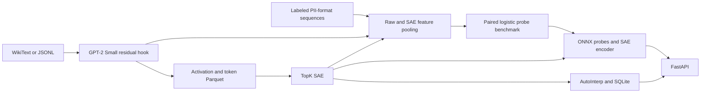

# ProbeKit v2 MVP

ProbeKit is a research-to-deployment pipeline for comparing raw GPT-2 residual
stream probes with probes trained on sparse autoencoder latents.

**Result.** The raw probe performed better on the synthetic OOD split. On the
in-distribution test set, the SAE probe had higher F1 and the raw probe had
higher AUROC. The comparison covers a single trained SAE and synthetic
format-detection data. [Full benchmark](runs/probe-comparison.md)

## Architecture



## Quickstart

Use Python 3.11 and uv. Set `UV_PROJECT_ENVIRONMENT` if your virtual environment
lives outside the repo. [uv documentation](https://docs.astral.sh/uv/)

```bash
uv sync --locked
uv run bash scripts/run_pipeline.sh
```

The demo uses GPT-2 Small on CPU and writes its inputs, reports, SQLite database,
and ONNX bundle under `data/demo`. The first run downloads the model. Pass
`--model-dir /path/to/snapshot` to reuse an existing local GPT-2 snapshot.
A measured cached-model run completed in 87.58 seconds. The demo's offline
explainer emits placeholders. Use a Haiku-backed run for semantic feature labels. [Demo run](runs/demo-smoke.json)

## Reproduce the measured comparison

```bash
uv run python scripts/make_synthetic_pii.py data/examples/pii_detection.jsonl
uv run probekit harvest --config configs/benchmark_cpu.yaml
uv run probekit train-sae --config configs/benchmark_cpu.yaml --sae-config configs/sae_benchmark_cpu.yaml
uv run probekit eval-sae --config configs/benchmark_cpu.yaml --sae-config configs/sae_benchmark_cpu.yaml --sae-lens
uv run probekit compare --config configs/benchmark_cpu.yaml
uv run probekit export --config configs/benchmark_cpu.yaml --profile
uv run probekit serve --config configs/benchmark_cpu.yaml
```

The measured CPU config uses a pinned WikiText-103 prefix and smaller SAE. The
default research config increases the corpus and dictionary and selects CUDA
when PyTorch detects it. Config paths resolve relative to the YAML file. The
GPT-2 hook uses zero-based block numbers. The first token stays in the model
context and is omitted from the stored activations because it can behave as an
attention sink. The sidecar contains original text and exact unpadded input IDs.

For live feature explanations, set `ANTHROPIC_API_KEY` and run:

```bash
uv run probekit autointerp --config configs/benchmark_cpu.yaml --n-features 100
```

AutoInterp stores its cache in SQLite and writes a CSV and detection-score
histogram. Restart the API to load labels added after startup. To train an
individual probe, use `probekit train-probe --concept pii --space raw` or
`--space sae`, along with the same model and probe configs.

## Measured CPU results

The SAE and raw probes used the same data, held-out splits, pooling, and
validation grid. The report includes per-seed results and a sample-efficiency
curve for 50, 200, and 1,000 labeled examples. [JSON](runs/probe-comparison.json) · [Curve](runs/probe-sample-efficiency.png)

| Split | Probe | F1 | Precision | Recall | AUROC | Nonzero weights |
| --- | --- | ---: | ---: | ---: | ---: | ---: |
| Test | Raw | 0.8778 | 0.8756 | 0.8800 | 0.9633 | 1,536 |
| Test | SAE | 0.8872 | 0.9105 | 0.8650 | 0.9593 | 1,688 |
| OOD | Raw | 0.7282 | 0.7474 | 0.7100 | 0.8327 | 1,536 |
| OOD | SAE | 0.4552 | 0.7333 | 0.3300 | 0.6772 | 1,688 |

The layer-8 SAE benchmark used a 30,000-input-token WikiText-103 prefix and a
1,024-feature TopK dictionary. The published JBloom weights were evaluated on
the Hugging Face residual stream at the equivalent hook location. Differences
in training corpora, dictionary size, and TransformerLens residual conventions
limit architectural comparisons. [Harvest](runs/harvest.json) · [Training](runs/sae-training.json) · [Held-out evaluation](runs/sae-metrics.json)

| SAE | L0 | Reconstruction MSE | Variance explained | Dead features | LM loss recovered |
| --- | ---: | ---: | ---: | ---: | ---: |
| Trained TopK | 32.00 | 6.216 | 0.370 | 6.74% | 84.06% |
| JBloom pretrained | 270.32 | 30.259 | -2.067 | 0.24% | 94.78% |

The application timings include tokenization, GPT-2, pooling, and scoring.
The SAE path also includes its encoder and NumPy TopK. Timings exclude HTTP
transport and startup. [Latency measurements](runs/latency.json) · [ONNX parity](runs/onnx-parity.json)

| Path | GPT-2 forward p50 | Probe-only ONNX p50 | Application p50 | Application p95 |
| --- | ---: | ---: | ---: | ---: |
| Raw | 61.56 ms | 0.098 ms | 62.27 ms | 72.07 ms |
| SAE | 60.91 ms | 0.059 ms | 63.29 ms | 69.28 ms |

## API and Docker

After exporting the benchmark bundle, run `docker compose up --build` for the
CPU API. The data bind mount provides the ONNX artifacts and persistent SQLite
database. The model cache has a separate volume. [Container smoke run](runs/docker-smoke.json)

```bash
curl http://localhost:8000/health
curl -X POST http://localhost:8000/probe -H 'Content-Type: application/json' \
  -d '{"text":"The note contains the example address alex@desk.invalid.","concept":"pii"}'
curl -X POST http://localhost:8000/features/activate -H 'Content-Type: application/json' \
  -d '{"text":"The note contains the example address alex@desk.invalid."}'
```

The default API uses the raw PII probe. Switch `probe_space` in the serving
YAML to use the SAE probe. Feature activations always use the SAE encoder.
TopK runs in NumPy so the ONNX encoder keeps a portable affine graph and
serving controls the selection policy explicitly.

## Limitations

- Synthetic labels capture identifier formats and near misses. Real PII
  recognition needs an external evaluation on representative data.
- The headline result covers one model, layer, SAE checkpoint, and synthetic
  split design. The label-budget error bars measure variation across sampled
  training subsets.
- AutoInterp scores measure held-out detection by a configured explainer.
  The checked runs used the offline placeholder provider and a mocked client.
- ProbeKit is a research-to-deployment MVP. Its local API assumes trusted
  callers and trusted model artifacts.

See [SPEC.md](SPEC.md) and [implementation decisions](docs/DECISIONS.md).
